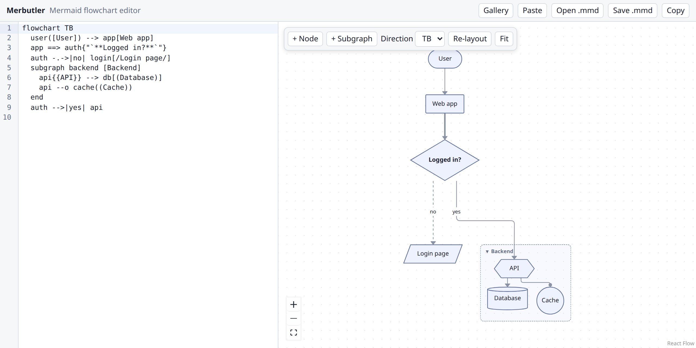
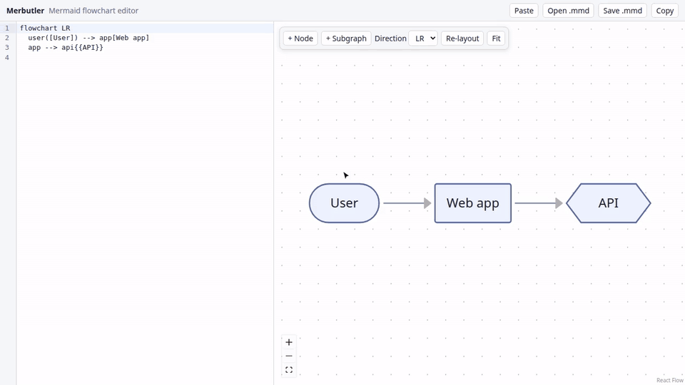
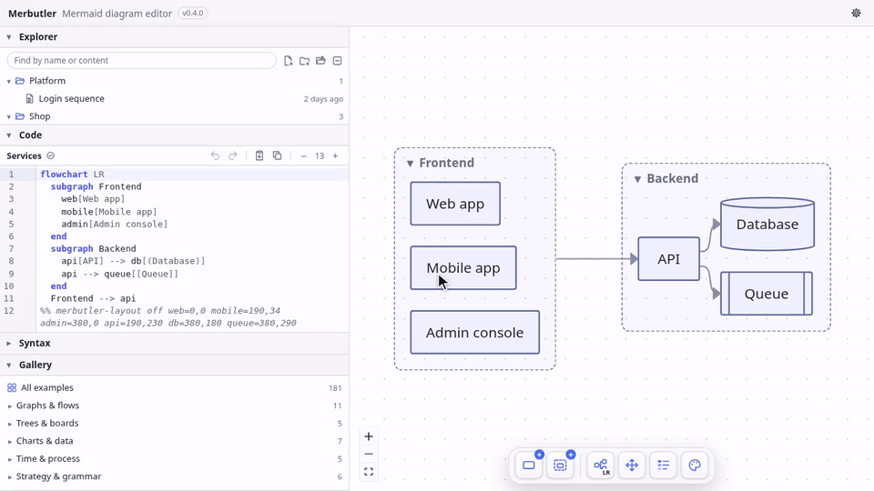
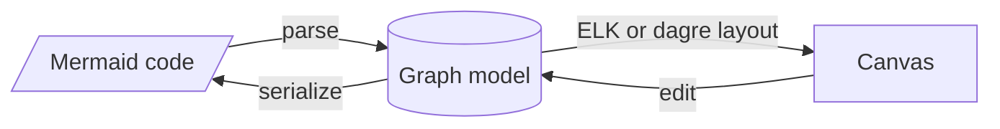
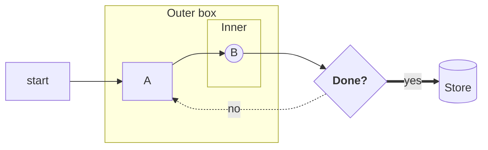

# Merbutler

**A visual editor for Mermaid diagrams.** Edit the code or the canvas, and the other side follows.

**Try it: [dellambrogio.github.io/merbutler](https://dellambrogio.github.io/merbutler/)**

Flowcharts, swimlanes, state diagrams and use case diagrams are edited on a canvas. Trees (mindmaps, treemaps, kanban boards, …) get an
outline editor, and data diagrams (pie, gantt, sequence messages, …) a table, next to Mermaid's own drawing. Every
other Mermaid diagram type opens as a preview.

Paste a flowchart from a doc or an agent's answer, rearrange it with the mouse, and copy clean Mermaid back out.
Everything runs in the browser: no server, no account.

<picture>
  <source media="(prefers-color-scheme: dark)" srcset="docs/screenshot-dark.png">
  
</picture>

### Demo



Type code and the canvas follows. Rename a node, change its shape, add a connected node, or flip the direction,
and the code follows; undo and redo sit above the code. The Gallery, at the bottom of the sidebar, shows examples of
every diagram type. The dock (the tools at the bottom of the canvas) and every panel can be dragged out of the way, and panels resized by their corner; the link keeps where they are and their size.
([MP4 version](docs/demo.mp4))



Mermaid stacks the three apps in a column. In the free layout, drag one until it snaps into line with the others,
then **Code from layout** writes the row into the code (an invisible subgraph and `~~~` links), so Mermaid's own
layout keeps it, here and in any other Mermaid renderer. ([MP4 version](docs/layout-demo.mp4))

### How the sync works



## Contents

- [Features](#features)
- [Quick start](#quick-start)
- [How it works](#how-it-works)
- [Code editor](#code-editor)
- [Saved diagrams](#saved-diagrams)
- [Paste](#paste)
- [Canvas actions](#canvas-actions)
- [Every diagram type](#every-diagram-type)
- [Supported Mermaid subset](#supported-mermaid-subset)
- [Known limitations](#known-limitations)
- [Project layout](#project-layout)
- [Versions and release notes](#versions-and-release-notes)
- [License](#license)

## Features

- ✍️ **Two-way sync**: type code and the canvas updates; edit the canvas and the code is regenerated.
- 🧩 **Subgraphs**: nested, with their own direction, and edges to or from a whole subgraph.
- 🎨 **Styling without syntax**: color swatches and pickers for nodes and edges, and a panel to create, edit and apply
  style classes (`classDef`).
- ✋ **Free layout**: place nodes anywhere, with guides that snap them into line. The positions are kept in a `%%`
  comment that Mermaid ignores, and the code follows the drawing (direction and statement order), so other renderers
  come close to it. **Code from layout** goes further: the rows and columns you lined up become invisible subgraphs
  that Mermaid itself keeps in line.
- 🔷 **All 53 node shapes** and all Mermaid flowchart edge styles and end markers.
- 📝 **Rich labels**: quoted text, line breaks and Markdown bold/italic.
- 💾 **Saved diagrams**: keep many named diagrams in folders in your browser, in the **Explorer**; the open one saves itself as you edit.
- 📋 **Smart paste**: strips Markdown code fences, so you can paste a chat answer as it is.
- 🛡️ **Safe by design**: unsupported syntax makes the canvas read-only instead of losing your code,
  and HTML in labels never runs.
- 🗂️ **Every Mermaid diagram type**: the canvas edits flowcharts, swimlanes (`swimlane-beta`), state diagrams and
  use case diagrams;
  outline and table editors cover the others; the rest open as Mermaid's own drawing, with pan and zoom.
- 🖼️ **Gallery**: examples of every Mermaid diagram type, drawn by Mermaid. The overview shows one tile per type,
  grouped into families (graphs and flows, trees and boards, charts and data, time and process, strategy and
  grammar), each with how the app edits it. Search the titles and code (`/`), or filter by Canvas, Outline, Table or
  Preview. A tile opens the type's page with all its examples, next to a list of all types (the open one in color, the others greyed out; ↑ ↓ move through it); the Flowchart page also has one example per feature
  of the flowchart syntax. Click an example to open it; Esc goes back, then closes.
- 📖 **Syntax reference**: a cheat sheet for every diagram type, in the Syntax panel under the code (for the type
  of the code, or one picked from a list) and on each gallery type page. Hovering over a keyword or arrow in the
  code (`-->`, `participant`, `||--o{`) shows what it means in a tooltip; with **Highlight syntax** on, the panel
  also marks the entry for the one at the cursor or in the selection. Works offline.
- ⚙️ **Settings**: theme (system, light or dark), code font size, line wrapping, syntax tooltips, syntax highlighting in the Syntax panel and gallery
  preview size, in a dialog from the header. They apply at once and are kept in this browser's local storage.
- 🔗 **Links**: the URL after `#` holds the diagram (compressed) and the gallery view, and follows your edits.
  Copy the address to share exactly what you see; opening it restores it. The URL wins over the autosaved code.
- 💾 **Autosave**: the code is kept in localStorage between sessions.

## Quick start

To use it, open [dellambrogio.github.io/merbutler](https://dellambrogio.github.io/merbutler/): nothing to install.
It is deployed by `.github/workflows/pages.yml` on every push to `main`.
What changed in each version is in [CHANGELOG.md](CHANGELOG.md), which the About dialog also shows.

To run it locally, you need [Node.js](https://nodejs.org/) and [just](https://github.com/casey/just).

```sh
just install
just dev        # open the URL that Vite prints
```

| Recipe | What it does |
|---|---|
| `just dev` | Start the dev server |
| `just test` / `just watch` | Run the tests once / in watch mode |
| `just check` | Type-check without building |
| `just ci` | Type-check and test |
| `just build` | Type-check and build to `dist/` |
| `just preview` | Build and serve the production build |
| `just clean` | Remove build output |
| `just deploy` | Run the GitHub Pages workflow on `main` and follow it (needs `gh`) |
| `just media` | Redo the README screenshots and demo video in `docs/` (needs `google-chrome` and `ffmpeg`) |

`just` alone lists all recipes. Without `just`, use `npm install`, `npm run dev`, `npm test` and `npm run build`.

## How it works

- **Code → canvas:** the code is parsed 300 ms after you stop typing. If the parse fails,
  the canvas keeps the last valid diagram and becomes read-only until the code is valid again.
- **Canvas → code:** each canvas edit regenerates the full code from the model.
- **View:** it fits the diagram again when nodes are added or removed, or the direction changes.
  Renames and style edits do not move the view.
- **Layout** is automatic and uses the engine Mermaid 12 uses: ELK, or dagre when the config says `layout: dagre`.
  ELK gets the options Mermaid gives it, including the `elk:` config (`preset`, `nodePlacementAlignment`,
  `nodePlacementStrategy`, `considerModelOrder`, …). The **Diagram** panel (dock → **Diagram**) sets them in the front matter,
  for example to line nodes up to one side, or to keep them in the order of the code. It picks the engine by what it
  does: **Hierarchical** (dagre) arranges nodes in ordered levels following their hierarchy; **Adaptive** (ELK, the
  default) rearranges nodes based on their context to keep the diagram organized.
  With ELK, edges follow the routes ELK found, as in Mermaid. Mermaid code has no positions, so the canvas always
  shows the layout: dragging a node or subgraph moves it into the subgraph you drop it on (highlighted while you
  drag), or to the top level when you drop it outside its subgraph. A drop that changes nothing puts it back.
- **Free layout** (dock → **Free layout**) lets you place nodes anywhere, and they stay where you drop them. The
  positions go in a comment at the end of the code, `%% merbutler-layout a=120,40 b=300,40`, that Mermaid ignores:
  Merbutler shows your arrangement again when it opens the code, and every other Mermaid renderer lays the diagram
  out as usual. So that their layout comes close to yours, each drop also updates the code: the direction becomes
  the one most arrows point to, and nodes, subgraphs and edges are written in reading order (rank by rank along
  the direction). Turning it on changes nothing on the screen: what you have not moved keeps Mermaid's drawing, and
  the edges of a moved element become straight lines. A subgraph whose contents moved is drawn around them; drop a
  node inside or outside it to move it in or out. Elements without a position yet (new ones, or ones typed in the code)
  go next to a linked element. Turning it off shows Mermaid's layout again and keeps your positions in the code
  (`%% merbutler-layout off …`): turning it on puts every node back where you left it. Delete the line to forget
  them. Not for swimlanes, whose lanes are bands.
  While you drag, a node snaps into line with another one when their centers come within a few pixels, across or
  down, and a guide line shows the line; hold Alt to drag without snapping.
- **Code from layout** (dock, with the free layout on) writes the rows and columns you lined up into the code, so
  Mermaid's own layout keeps them in line too: each becomes an invisible subgraph (`row1`, `col1`, class
  `layoutAlign`) with the direction of the line, and neighbors not linked yet get an invisible link (`~~~`). A
  message says what it did, and the groups are outlined for a moment. Only lines whose nodes have no links to the
  rest of the diagram are grouped: Mermaid ignores a subgraph's direction when it is linked to the outside, and
  there the groups did not help. `just mermaid-check` draws the cases with Mermaid itself, with dagre and ELK.

## Code editor

- **Syntax highlighting** for the flowchart syntax (keywords, edges, labels, `@{}` data, styling, front matter,
  comments), in light and dark mode. Other diagram types get a simpler mode: their keywords, strings, numbers,
  arrows and comments.
- **Header completion** for all diagram types (`sequenceDiagram`, `stateDiagram-v2`, `xychart-beta`, …), and each
  type's keywords at the start of a line.
- **Autocompletion** (as you type, or Ctrl+Space): statements, directions, node and subgraph ids of the diagram,
  all shape names and aliases in `@{ shape: … }`, `@{}` keys and values, class names, curves, themes and looks in the
  front matter, and FontAwesome icon names after `fa:fa-` or in `icon: "…"`.
- **Errors** are underlined on their line, with a mark in the gutter (Mermaid's line numbers are mapped back to the
  editor's, also when comments were removed).
- **Editing:** Ctrl+/ toggles `%%` comments, Tab indents (Esc then Tab leaves the editor), lines inside a subgraph
  indent automatically and `end` steps back, brackets and quotes close, Ctrl+F searches.
- **Text size:** **A−** / **A+** below the code (Ctrl+Alt+− / Ctrl+Alt+=, Ctrl+Alt+0 resets). It is remembered.

## Undo and redo

- **↶** / **↷** in the header, or **Ctrl+Z** and **Ctrl+Shift+Z** / **Ctrl+Y** (Cmd on a Mac), in the code panel or
  on the canvas. One history covers the code, the canvas and the outline and table editors: an edit on the canvas
  is undone from the code panel too.
- Typing is one step until a pause of a second. A color dragged in a picker is one step.
- Pasting, an example or a link can be undone. Opening a saved diagram starts its own history.
- Inspector fields keep the browser's own undo while you type in them.

## Saved diagrams

Diagrams are kept in this browser's local storage: nothing goes to a server, and another browser or a private
window does not see them.

- The left column stacks panels you open and close with a click on their title: **Explorer** on top, **Code**, and
  **Syntax**. Drag the edge between two panels to give one more height.
- **Explorer** shows the saved diagrams as a tree of folders and files, folders first, by name. Click a diagram to
  open it, a folder to open or close it. Drag a diagram or a folder onto a folder to move it there, or onto the empty
  part of the tree for the top level. The buttons on a row (on hover) add a diagram or a folder in it, rename (**F2**),
  duplicate, download as a `.mmd` file, and delete (**Del**). The ones at the top add a diagram or a folder at the top
  level, open a `.mmd` file from disk (saved as a new diagram, named after the file), and find a diagram by name or
  content. Names are unique within a folder. Deleting a folder deletes the diagrams in it, after asking.
- **Save** (or **Ctrl+S**) keeps the open code under its front matter `title`, or "Untitled".
- The open saved diagram saves itself as you edit (also when you leave the page). The header shows its name and **saved**.
- Pasting, an example from the gallery, or a link with other code starts a new, unsaved diagram, so it never overwrites a saved one. Opening a saved diagram over unsaved work asks first.
- A deleted diagram cannot be restored. Deleting the open one keeps its code in the editor, unsaved.
- Two tabs see each other's list. If both edit the same diagram, the last change wins.

## Paste

- **Paste** button, or **Ctrl+V on the canvas**: replaces the whole code with the clipboard.
- Markdown code fences are removed. If the text has several blocks, the first `mermaid` block is used.
  This lets you copy an agent's answer as it is.
- Ctrl+V in the code panel removes the fence only when the paste replaces all the code
  (empty editor or all text selected). Other pastes insert the text as it is.
- **Ctrl+Z** (or **↶**) undoes a paste, wherever the focus is.
- The Paste button needs clipboard permission. If the browser blocks it, use Ctrl+V on the canvas.

## Canvas actions

| Action | How |
|---|---|
| Add node | **+ Node** opens a menu of every shape, by group, with a search (`diamond`, `db`, `(`); the node gets the shape you pick and goes into the selected subgraph. In a state diagram, **+ State** adds a state at once |
| Add image or text | **+ Image**: an image node (`@{ img }`) with Mermaid's placeholder image; put your image's URL in its panel. **+ Text**: a text block without a box (`@{ shape: text }`). Flowcharts and swimlanes |
| Add subgraph | **+ Subgraph** with nothing selected (an empty subgraph; inside a selected lane or region) |
| Group into a subgraph | Select nodes and subgraphs, then **Group in subgraph** (the same button) or **Ctrl+G**. The new subgraph goes where they all are |
| Align nodes | Toolbar → **Layout**: alignment, node placement, code order, layers, loops, Mermaid's presets. Each choice is written to the front matter (`config: elk:`); **Default** removes it. A tag (`11.17+`, `12+`) marks options that older Mermaid versions ignore: some sites still run one, and lay the diagram out with their defaults |
| Rename node | Double-click the node, or use the inspector. **Enter** saves, **Shift+Enter** adds a line break |
| Rename subgraph | Double-click its title, or use the inspector |
| Move into / out of a subgraph | Drag it onto the subgraph (or out of it), or select it → inspector → **Subgraph** |
| Markdown label | Select the node, edge or subgraph → inspector → **Markdown** |
| Change shape | Select the node → inspector |
| Connect | Hover over a node or subgraph to show its handles, then drag from a handle and drop it on a handle of another node or subgraph |
| Edge label, line, end marker, both ends, length, curve | Select the edge → inspector: the line (normal, dotted, thick, invisible), the marker (none, arrow, circle, cross), the length (1–3 ranks) and the curve (each drawn with Mermaid's own curve) are picked from small drawings |
| Colors and text style | Select a node, subgraph or edge → inspector → **Own style**: swatches or any color for fill, border (or line) and text, border width and style, bold, italic. Written as `style id …` / `linkStyle n …`; **Reset** removes it, **Advanced** shows it as text |
| Style classes | Dock → **Classes**: every `classDef` with a preview and how many elements use it. Create, rename, edit (same controls as above) and delete classes; rename and delete update every element. With elements selected, **＋ / −** adds or removes a class on them. In the inspector, the class chips do the same for one element |
| Delete | Select, then `Delete`/`Backspace`, or the inspector button. Deleting a subgraph keeps its contents: they move up one level |
| Direction | Toolbar select. In a free layout, moving nodes sets it from the drawing |
| Free layout | Dock → **Free layout**: drag nodes and subgraphs anywhere; they snap into line with others (Alt: no snapping), and their positions are kept in the code. Click again for Mermaid's layout, and once more to put your nodes back |
| Code from layout | Dock → **Code from layout** (free layout on): the rows and columns you lined up become invisible subgraphs with `~~~` links, so Mermaid keeps them in line. Click again after moving nodes |
| Context menu | Right-click a node, subgraph, edge or the empty canvas (or press the ContextMenu key or Shift+F10 on the selection). Nodes: rename, add a connected node, duplicate, shape, move to a subgraph, delete. Edges: edit label, reverse, stroke, end markers, delete. Subgraphs: rename, add inside, collapse, direction, move, delete. Canvas: add elements, direction, fit. State and use case diagrams get their own entries (next state, type, `[*]`, notes, relations) |

## Every diagram type

| Diagram types | How the app edits them |
|---|---|
| Flowchart, swimlane (`swimlane-beta`) | **Canvas.** Swimlanes are drawn as lanes (rows for `LR`, columns for `TB`), laid out with one ELK partition per lane. **+ Lane** adds one |
| State diagram (`stateDiagram-v2`) | **Canvas.** States, `[*]` start and end (**+ Start**, **+ End**, per composite state), choice, fork and join, composite states (**+ Composite**) with their own direction, concurrency regions (inspector → **+ Concurrent region**), notes (**+ Note**), transition labels, `classDef`/`class`/`style`. Comments are kept, at the end. What the canvas cannot keep (a floating note) opens as a preview that says why |
| Use case diagram (`usecase-beta`) | **Canvas.** Actors (**+ Actor**: stick figure, hollow, awesome or icon, business, stereotype), use cases (**+ Use case**: ellipse or rectangle), system boundaries (**+ Boundary**, rect or package), notes (**+ Note**), and relationships: associations with every arrow (`-->`, `--`, `<--`, `--o`, `o--`, `--x`, `x--`) and labels, `..>:include`, `..>:extend`, `--|>` generalization (only between the kinds Mermaid accepts). Edge ids, edge animation and JSON nodes open as a preview |
| Mindmap, ishikawa, treeView, treemap, kanban, venn | **Outline editor** next to the preview: add, indent (Tab), outdent (Shift+Tab), move (Alt+↑/↓), delete; typed fields per type (mindmap shape and icon, treemap value, tree view annotation, kanban card data) |
| Pie, sankey, packet, radar, XY chart, quadrant, timeline, user journey, gantt, git graph | **Table editor** next to the preview: one row per data line (sections as headings). Other lines (title, axes, settings) stay in the code |
| Sequence, class, ER, requirement, C4, architecture, block | **Table of relations** next to the preview (messages, relations, relationships, edges). Participants, classes, entities and blocks are edited in the code |
| Event modeling, Wardley map, Cynefin, railroad (IR, EBNF, ABNF, PEG) | **Preview** only: edit them in the code |

The outline and table editors write only the lines they change (the outline rewrites the tree's indentation).
Mermaid draws every preview with `securityLevel: strict`, the same as the gallery.

## Supported Mermaid subset

The canvas reads this flowchart syntax:

| Feature | Syntax |
|---|---|
| Diagram | `flowchart` / `graph` with `TB`, `TD`, `BT`, `LR`, `RL` |
| Shapes | `[rect]`, `(round)`, `([stadium])`, `[[subroutine]]`, `[(cylinder)]`, `((circle))`, `(((double circle)))`, `>flag]`, `{diamond}`, `{{hexagon}}`, `[/parallelogram/]`, `[\parallelogram\]`, `[/trapezoid\]`, `[\inverted trapezoid/]` |
| Shapes, new syntax | `A@{ shape: …, label: "…" }` with all 53 shapes of Mermaid 12.3 and their aliases, from `doc` and `cloud` to `fork` and `person`. The 14 shapes above can be written either way. The syntax and the name (alias included) are kept |
| Edge strokes | normal `--`, dotted `-.-`, thick `==`, invisible `~~~` (drawn faintly on the canvas so you can select it) |
| Edge ends | `>` arrow, `o` circle, `x` cross or none, on one end (`-->`, `--o`, `-.-x`, `==>`) or both (`<-->`, `o--o`, `x-.-x`, `<==>`) |
| Edge labels | `-->|label|` or `-- label -->` |
| Edge length | `--->`, `---->` (2 or 3 ranks) for every stroke: `-..->`, `===>`. The canvas uses it with dagre; ELK has no per-edge length |
| Edge ids | `A e1@--> B` with `e1@{ animate, animation, step, curve }`. The canvas animates the edge (two speeds; still when the system asks for reduced motion), shows step numbers, and draws `linear` and `step` curves; smooth curves use its own |
| Before the `flowchart` line | front matter (`title`, `config`), `%%{init}%%` directives and comments: kept as they are. The canvas shows the `title` |
| Themes and looks | `theme` (all 11 Mermaid 12 themes, from `default` and `forest` to `neo` and `redux-dark`), `themeVariables` (`primaryColor`, `primaryBorderColor`, `primaryTextColor`, `lineColor`, `clusterBkg`, `clusterBorder`, …) and `look` (`classic`, `neo` with shadows, `handDrawn` with wobbly outlines), from the front matter or a directive. Without them the canvas uses its own colors, which follow light and dark mode. Labels wrap at `flowchart.wrappingWidth` (200 by default) unless `markdownAutoWrap: false` |
| Styling | `classDef` (also `default`), `class`, `:::`, `style` on nodes and subgraphs, `linkStyle` (by index and `default`, also `interpolate`), classes on edges with an id. The canvas draws fill, stroke, stroke width, dashes, text color and font; other properties are kept in the code. Edit classes and style in the inspector |
| Icons and images | `A@{ icon: "fa:user", form, label, pos, h }` and `A@{ img: "…", label, pos, w, h, constraint }`. The free FontAwesome 6 packs are bundled (`fas` solid, `far` regular, `fab` brands, `fa` all three) and load only when a diagram uses an icon; other icon sets (`mdi:…`, `logos:…`) show their name. `data:` images are shown at once; images from a server only after you click **Load** for that server (for this session), so a pasted diagram never makes the canvas contact a server on its own |
| FontAwesome in labels | `fa:fa-twitter`, `fab:fa-github`, … drawn as icons from the bundled packs, as Mermaid does with registered packs. Paid packs (`fal`, `fak`) stay text |
| Interaction | `click id …` in every form (link, `href`, callback, `call fn()`, tooltip, target), kept exactly as written and shown as a badge. The canvas never follows a link or runs a callback |
| Collapsed subgraphs | `id@{ view: collapsed }`: drawn as one box, edges that cross its border end at the box, like Mermaid. Toggle with the arrow in its title or the inspector |
| Labels | quoted text with any characters (`"a & (b)"`), `<br>` line breaks, Markdown strings (`` "`**bold** and *italic*`" ``) on nodes, edges and subgraphs |
| Subgraphs | `subgraph id [Label] … end`, nested, optional `direction` inside, edges to or from a subgraph (`ingest --> store`) |

Example:



Open the **Gallery** in the app to see every feature of the Mermaid flowchart syntax, every Mermaid diagram type,
and how the app edits each.

Code the canvas cannot represent shows an error, and the canvas stays read-only. This prevents a canvas edit from
deleting those parts. Today every example in the Gallery is editable, and none loses code on a canvas edit.

## Known limitations

- A canvas edit rewrites the code: formatting, blank lines and statement order are not kept. Comments are kept: each
  `%%` comment goes with the node, edge or subgraph written after it (or before `end`, before the styling statements,
  or at the end), and is written back there. Deleting the element deletes its comment.
- `direction` inside a subgraph works as in Mermaid: the canvas uses it only if no edge connects a node inside
  the subgraph to a node outside it. Edges that end at the subgraph itself are allowed.
- Without an ELK route (dagre), edges use handles on fixed sides (for example right → left
  in LR), so an edge that goes against the flow direction can cross the nodes or subgraphs between its ends.
- The canvas places nodes like Mermaid's engine, but not pixel for pixel: node sizes are estimated from the text.
- A free layout is Merbutler's own: other renderers ignore the positions and lay the diagram out themselves, from the
  direction and statement order. Two edges between the same nodes are drawn on the same straight line.
- Code from layout leaves a row or column to Mermaid when its nodes link to the rest of the diagram, and a link that
  skips a node in a row (`a --> c` with `b` between) still pushes `b` a little off the line.
- A subgraph without an id (`subgraph Some title`) gets the id Mermaid gives it (for example `subGraph3`)
  after the first canvas edit.
- Labels are trimmed. An empty node label becomes the node id.
- `@{ label: … }` is always Markdown in Mermaid. A shape that exists only in the `@{}` syntax therefore turns a
  plain label into a Markdown label (`<br>` becomes a line break). A shape with brackets keeps a plain label by
  switching to the bracket syntax.
- Some shapes have no visible label in Mermaid (`fork`, `f-circ`, `sm-circ`, `fr-circ`, `cross-circ`, `hourglass`,
  `bolt`). The canvas does the same; edit their label in the inspector.
- Mermaid removes unknown HTML tags from labels (for example `<t>`). Other tags (for example `<b>`) are kept in
  the code but shown as text on the canvas; only `<br>` is shown as a line break. HTML from pasted code never runs.
- In a plain label a line break is saved as `<br>`; in a Markdown label as a real newline.
- The canvas shows Markdown bold and italic only, as Mermaid does in labels.
- Classes are written back as `class` statements (`A:::hot` becomes `class A hot`), in `classDef` order, which is
  also the order Mermaid applies them in.
- A style value with quotes, comments or `url(…)` is kept in the code but not drawn. A fill without a text color
  gets dark or light text on the canvas so the label stays readable.
- State diagrams: a canvas edit writes each state in its composite state and each transition in the innermost
  composite that holds both ends, and moves comments to the end. A state with quotes or line breaks in its label is
  written as `id : text` lines.
- Use case diagrams: a canvas edit writes actors, boundaries with their members, use cases, relationships and notes
  in that order, `class` statements instead of `:::`, and moves comments to the end.
- `src/flowchart/parseFlowchart.ts`, `src/state/stateDiagram.ts` and `src/usecase/usecaseDiagram.ts` use Mermaid internals
  (`mermaidAPI.getDiagramFromText`, the flowchart, state and use case DBs). The `mermaid` version is pinned. Run `just test` after you update it.

## Project layout

Built with React, [React Flow](https://reactflow.dev/), [CodeMirror](https://codemirror.net/),
[ELK](https://eclipse.dev/elk/), [dagre](https://github.com/dagrejs/dagre) and [Mermaid](https://mermaid.js.org/)'s own parser.

The code is grouped by diagram type where it is specific to one, and by concern where it is shared.

| Folder | Purpose |
|---|---|
| `src/core/` | Shared by every type: the graph model and its edits (`model.ts`), Mermaid setup and text helpers (`mermaid.ts`), parse and serialize by type (`parse.ts`, `serialize.ts`), free layout positions (`positions.ts`), the list of diagram types (`diagramTypes.ts`), labels, config, settings, the URL state, clipboard |
| `src/flowchart/` | Flowcharts and swimlanes: Mermaid's flowchart DB → model (`parseFlowchart.ts`), model → code (`serializeFlowchart.ts`), shapes, styling, themes, icons |
| `src/state/` | State diagrams: adapter, writer and edits (`stateDiagram.ts`) |
| `src/usecase/` | Use case diagrams: adapter, writer and edits (`usecaseDiagram.ts`) |
| `src/canvas/` | The canvas for every graph type: layout (dagre, ELK, lanes), node and edge views, dock, context menu, class drag and drop, shared panel fields |
| `src/structured/` | Outline and table editors next to the preview (trees, data, relations) |
| `src/preview/` | Mermaid's own drawing, with pan and zoom; one Mermaid call at a time |
| `src/editor/` | CodeMirror extensions for the code panel: highlighting, completion, error marks |
| `src/syntax/` | The syntax reference of every type, and finding the entry at the cursor |
| `src/gallery/` | Example diagrams of every type, and the gallery catalog |
| `src/sidebar/` | The sidebar panels: Code (`CodeEditor.tsx`, its toolbar `CodeToolbar.tsx`), Syntax (`SyntaxPanel.tsx`), Explorer (`Explorer.tsx`, storage and folders in `src/core/library.ts`), Gallery (`GalleryNav.tsx`), and their collapsible frame (`PanelSection.tsx`) |
| `src/panels/` | The floating panels, on one frame (`Panel.tsx`): node, edge, selection (`inspectors/` by diagram type), Diagram, Style classes, Palettes, and the About and Settings windows (versions come from `package.json` through `vite.config.ts`); moving and resizing (`draggablePanels.ts`) |
| `src/App.tsx` | Split view and sync logic |
| `tools/media/` | The README media: scripted headless Chrome sessions (`demo.mjs`, `layout-demo.mjs`, `screenshot.mjs`, staged by `stage.mjs`, with the pointer and recorder in `kit.mjs`), encoded by `media.sh` (`just media`) |
| `tools/mermaid-check/` | Code from layout checked against Mermaid itself: each case in `cases.mjs` drawn with dagre and ELK in headless Chrome (`just mermaid-check`) |
| `tests/` | Round-trip, layout, label, clipboard, swimlane, state, use case, outline, table, menu, settings and URL tests, with `.mmd` fixtures |

## Versions and release notes

The version is the `version` in `package.json`; the app shows it in the header and the About dialog
(`src/version.ts`). Every change goes under **Unreleased** in [CHANGELOG.md](CHANGELOG.md). To release, move those
notes under a new `## x.y.z — YYYY-MM-DD` heading and set the same version in `package.json`; the tests fail if the
version has no notes.

## License

MIT — see [LICENSE](LICENSE).
