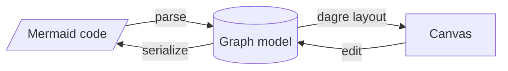
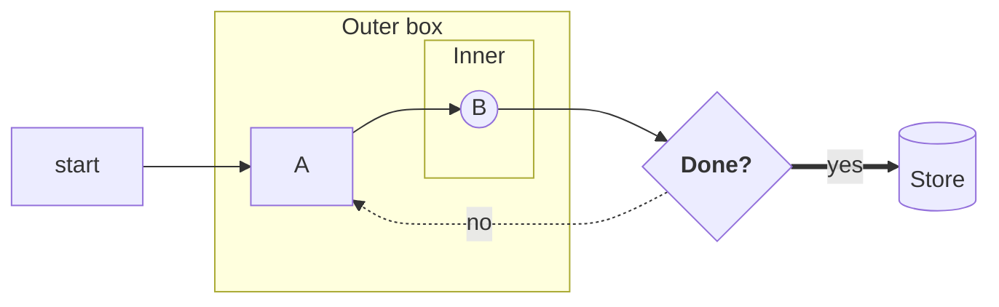

# Merbutler

**A visual editor for Mermaid flowcharts.** Edit the code or the canvas, and the other side follows.

Paste a flowchart from a doc or an agent's answer, rearrange it with the mouse, and copy clean Mermaid back out.
Everything runs in the browser: no server, no account.

<picture>
  <source media="(prefers-color-scheme: dark)" srcset="docs/screenshot-dark.png">
  
</picture>

### Demo


Type code and the canvas follows. Rename a node, change its shape, add and connect nodes, or flip the direction,
and the code follows. ([MP4 version](docs/demo.mp4))

### How the sync works



## Contents

- [Features](#features)
- [Quick start](#quick-start)
- [How it works](#how-it-works)
- [Paste](#paste)
- [Canvas actions](#canvas-actions)
- [Supported Mermaid subset](#supported-mermaid-subset)
- [Known limitations](#known-limitations)
- [Project layout](#project-layout)
- [License](#license)

## Features

- ✍️ **Two-way sync**: type code and the canvas updates; edit the canvas and the code is regenerated.
- 🧩 **Subgraphs**: nested, with their own direction, and edges to or from a whole subgraph.
- 🔷 **14 node shapes** and all Mermaid flowchart edge styles and end markers.
- 📝 **Rich labels**: quoted text, line breaks and Markdown bold/italic.
- 📋 **Smart paste**: strips Markdown code fences, so you can paste a chat answer as it is.
- 🛡️ **Safe by design**: unsupported syntax makes the canvas read-only instead of losing your code,
  and HTML in labels never runs.
- 🖼️ **Gallery**: one example per feature of the Mermaid flowchart syntax, drawn by Mermaid, with a badge
  that says whether the canvas can edit it. Click one to open it.
- 💾 **Autosave**: the code is kept in localStorage between sessions.

## Quick start

You need [Node.js](https://nodejs.org/) and [just](https://github.com/casey/just).

```sh
just install
just dev        # open the URL that Vite prints
```

| Recipe | What it does |
|---|---|
| `just dev` | Start the dev server |
| `just test` / `just watch` | Run the tests once / in watch mode |
| `just check` | Type-check without building |
| `just ci` | Type-check and test |
| `just build` | Type-check and build to `dist/` |
| `just preview` | Build and serve the production build |
| `just clean` | Remove build output |

`just` alone lists all recipes. Without `just`, use `npm install`, `npm run dev`, `npm test` and `npm run build`.

## How it works

- **Code → canvas:** the code is parsed 300 ms after you stop typing. If the parse fails,
  the canvas keeps the last valid diagram and becomes read-only until the code is valid again.
- **Canvas → code:** each canvas edit regenerates the full code from the model.
- **View:** it fits the diagram again when nodes are added or removed, or the direction changes.
  Renames and style edits do not move the view.
- **Layout** is automatic (dagre). You can drag nodes, but the next edit or **Re-layout** resets the positions.

## Paste

- **Paste** button, or **Ctrl+V on the canvas**: replaces the whole code with the clipboard.
- Markdown code fences are removed. If the text has several blocks, the first `mermaid` block is used.
  This lets you copy an agent's answer as it is.
- Ctrl+V in the code panel removes the fence only when the paste replaces all the code
  (empty editor or all text selected). Other pastes insert the text as it is.
- Ctrl+Z in the code panel undoes a paste.
- The Paste button needs clipboard permission. If the browser blocks it, use Ctrl+V on the canvas.

## Canvas actions

| Action | How |
|---|---|
| Add node | **+ Node** (goes into the selected subgraph, or next to the selected node) |
| Add subgraph | **+ Subgraph** (same rule) |
| Rename node | Double-click the node, or use the inspector. **Enter** saves, **Shift+Enter** adds a line break |
| Rename subgraph | Double-click its title, or use the inspector |
| Move into / out of a subgraph | Select the node or subgraph → inspector → **Subgraph** |
| Markdown label | Select the node, edge or subgraph → inspector → **Markdown** |
| Change shape | Select the node → inspector |
| Connect | Hover over a node or subgraph to show its handles, then drag from a handle and drop it on a handle of another node or subgraph |
| Edge label, stroke, end marker, both ends | Select the edge → inspector |
| Delete | Select, then `Delete`/`Backspace`, or the inspector button. Deleting a subgraph keeps its contents: they move up one level |
| Direction | Toolbar select |

## Supported Mermaid subset

| Feature | Syntax |
|---|---|
| Diagram | `flowchart` / `graph` with `TB`, `TD`, `BT`, `LR`, `RL` |
| Shapes | `[rect]`, `(round)`, `([stadium])`, `[[subroutine]]`, `[(cylinder)]`, `((circle))`, `(((double circle)))`, `>flag]`, `{diamond}`, `{{hexagon}}`, `[/parallelogram/]`, `[\parallelogram\]`, `[/trapezoid\]`, `[\inverted trapezoid/]` |
| Edge strokes | normal `--`, dotted `-.-`, thick `==` |
| Edge ends | `>` arrow, `o` circle, `x` cross or none, on one end (`-->`, `--o`, `-.-x`, `==>`) or both (`<-->`, `o--o`, `x-.-x`, `<==>`) |
| Edge labels | `-->|label|` or `-- label -->` |
| Labels | quoted text with any characters (`"a & (b)"`), `<br>` line breaks, Markdown strings (`` "`**bold** and *italic*`" ``) on nodes, edges and subgraphs |
| Subgraphs | `subgraph id [Label] … end`, nested, optional `direction` inside, edges to or from a subgraph (`ingest --> store`) |

Example:



Open the **Gallery** in the app to see every feature of the Mermaid flowchart syntax and its status.

Code with other features (invisible links `~~~`, `A@{ shape: … }`, `classDef`, `style`, `linkStyle`, `click`,
other shapes or arrow types) shows an error, and the canvas stays read-only. This prevents a canvas edit from
deleting those parts.

## Known limitations

- A canvas edit rewrites the code: comments, formatting, and statement order are not kept.
- Edge length (`--->`) is not kept.
- `direction` inside a subgraph works as in Mermaid: the canvas uses it only if no edge connects a node inside
  the subgraph to a node outside it. Edges that end at the subgraph itself are allowed.
- Handles are on fixed sides (for example right → left in LR). An edge that goes against the flow direction
  can cross the nodes or subgraphs between its ends.
- A subgraph without an id (`subgraph Some title`) gets the id Mermaid gives it (for example `subGraph3`)
  after the first canvas edit.
- Labels are trimmed. An empty node label becomes the node id.
- Mermaid removes unknown HTML tags from labels (for example `<t>`). Other tags (for example `<b>`) are kept in
  the code but shown as text on the canvas; only `<br>` is shown as a line break. HTML from pasted code never runs.
- In a plain label a line break is saved as `<br>`; in a Markdown label as a real newline.
- The canvas shows Markdown bold and italic only, as Mermaid does in labels.
- `src/parse.ts` uses Mermaid internals (`mermaidAPI.getDiagramFromText` and the flowchart DB).
  The `mermaid` version is pinned. Run `just test` after you update it.

## Project layout

Built with React, [React Flow](https://reactflow.dev/), [CodeMirror](https://codemirror.net/),
[dagre](https://github.com/dagrejs/dagre) and [Mermaid](https://mermaid.js.org/)'s own parser.

| File | Purpose |
|---|---|
| `src/model.ts` | Graph model and edit operations |
| `src/parse.ts` | Mermaid text → model |
| `src/serialize.ts` | Model → Mermaid text |
| `src/layout.ts` | Model → positioned React Flow nodes and edges |
| `src/labels.ts`, `src/LabelText.tsx` | Label line breaks and Markdown, rendered as safe React elements |
| `src/clipboard.ts` | Extracts Mermaid code from pasted text and code fences |
| `src/Canvas.tsx` | Canvas, toolbar and inspector |
| `src/ShapeNodeView.tsx`, `src/SubgraphNodeView.tsx` | Node shapes and subgraph boxes |
| `src/LabelEdgeView.tsx`, `src/EdgeMarkers.tsx` | Edges with HTML labels, circle and cross end markers |
| `src/CodeEditor.tsx` | CodeMirror panel |
| `src/App.tsx` | Split view and sync logic |
| `src/gallery.ts`, `src/Gallery.tsx` | Syntax examples and the gallery panel |
| `tests/` | Round-trip, layout, label and clipboard tests, with `.mmd` fixtures |

## License

MIT — see [LICENSE](LICENSE).
